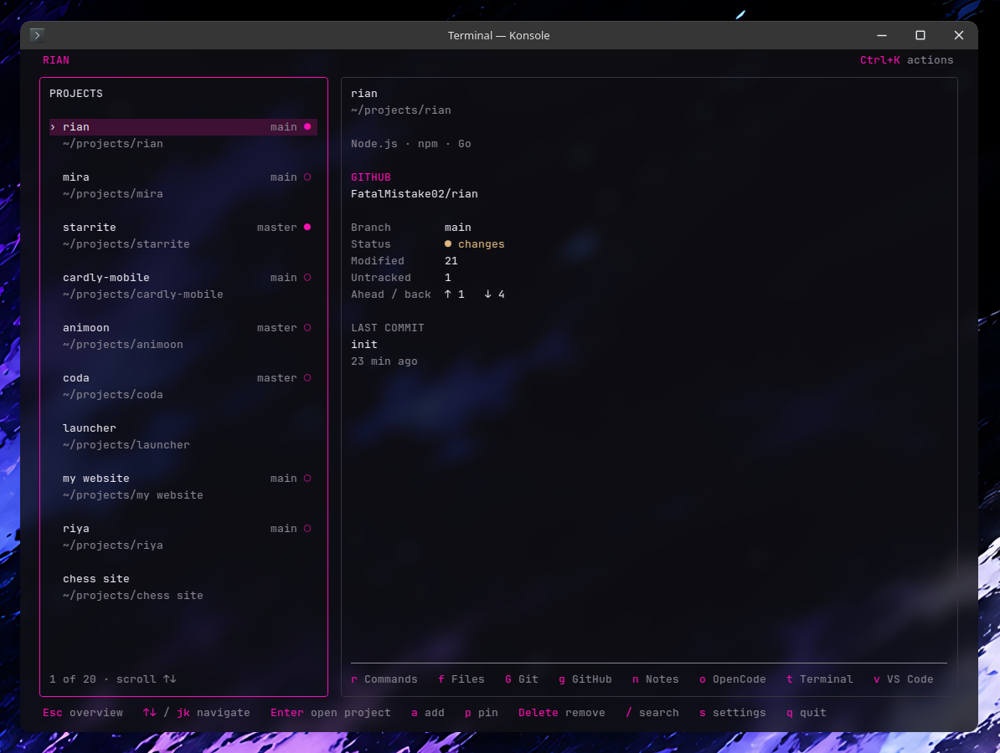

# Rian

Rian is a terminal app for managing local development projects, running commands, and working with Git.



## Install

Supports macOS, Linux, and Windows on ARM64 and x64.

**macOS / Linux** — standalone, no runtime required:

```sh
curl -fsSL https://github.com/FatalMistake02/rian/releases/latest/download/install.sh | sh
```

**Homebrew:**

```sh
brew tap fatalmistake02/rian https://github.com/FatalMistake02/rian
brew install fatalmistake02/rian/rian
```

**npm** — requires Node.js 22+:

```sh
npm install -g @fatalmistake02/rian
rian
```

**Bun:**

```sh
bun add -g @fatalmistake02/rian
bun run --bun rian
```

Or run without installing: `npx @fatalmistake02/rian` or `bunx --bun @fatalmistake02/rian`.

[Standalone downloads](https://github.com/FatalMistake02/rian/releases/latest) include Windows ZIPs. Extract the archive and put `rian.exe` in a directory on your `PATH`.

## Updates

Rian checks for updates at startup and hourly. Update from the app or run `rian update`; it uses npm, Bun, or Homebrew for managed installs and verifies checksums before replacing standalone binaries. Use `rian update --check` to check without installing.

## Features

- Project search, favorites, and notes.
- VS Code, OpenCode, KiloCode, a terminal, and a file manager.
- Git status, commit graphs, branches, commits, and remotes.
- Detected and custom commands, folder discovery, and JSON addons.

Install the tools you use and make them available in `PATH`. Run `rian --help` for CLI commands.

## Docs

- [Configuration](docs/configuration.md)
- [Addons](docs/addons.md)
- [Development](docs/development.md)

## License

[MIT](LICENSE). [Third-party notices](THIRD_PARTY_NOTICES.txt).
