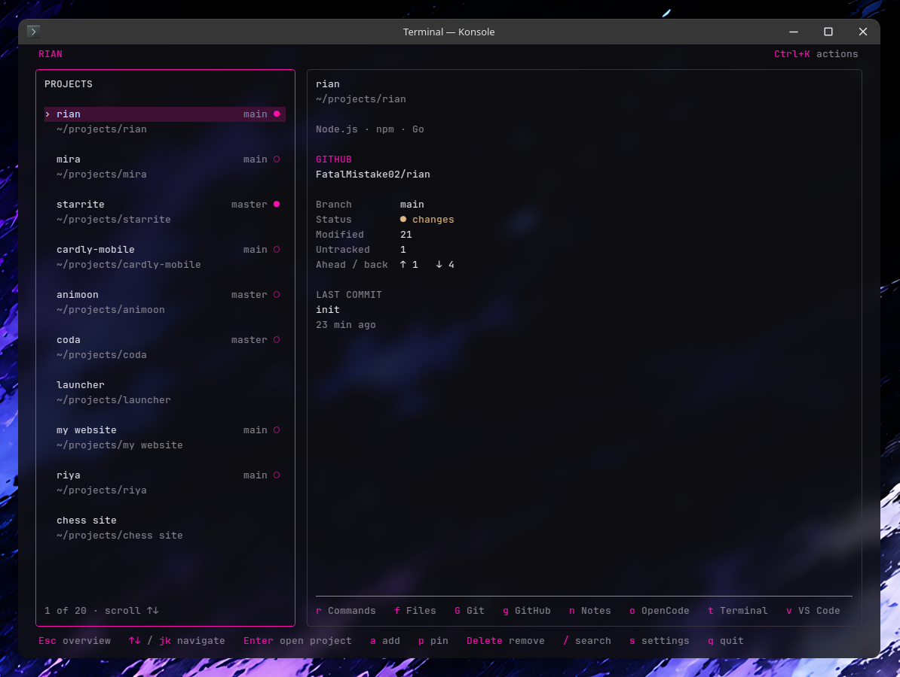

# Rian

Rian is a terminal app for managing local development projects, running commands, and working with Git.



## Install

Requires **Node.js 22+**. Supports macOS, Linux, and Windows on ARM64 and x64.

```sh
npm install -g @fatalmistake02/rian
rian
```

Or run it with `npx @fatalmistake02/rian`.

## Features

- Project search, favorites, and notes.
- VS Code, OpenCode, KiloCode, a terminal, and a file manager.
- Git status, commit graphs, branches, commits, and remotes.
- Detected and custom commands, folder discovery, and JSON addons.

Install the tools you use and make them available in `PATH`. Run `rian --help` for CLI commands.

## Docs

- [Configuration](docs/configuration.md)
- [Addons](docs/addons.md)
- [Development](docs/development.md)

## License

[MIT](LICENSE). [Third-party notices](THIRD_PARTY_NOTICES.txt).
